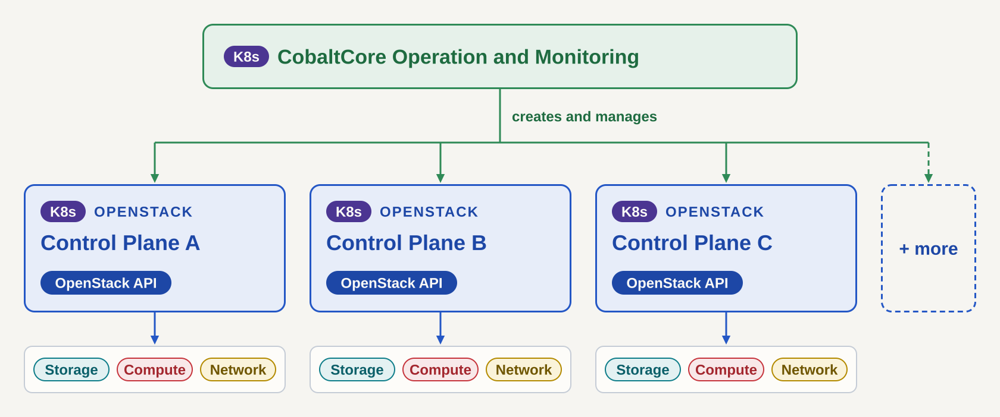
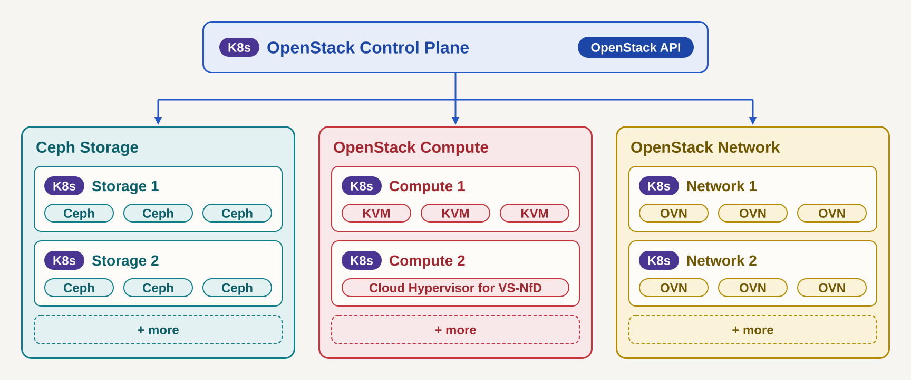

# Architecture

CobaltCore (C5C3) is a Kubernetes-native OpenStack distribution for operating
Hosted Control Planes. Its design originates in the
[C5C3 architecture document](https://c5c3.github.io/C5C3/), an early-concept
sketch of the full multi-cluster system. This page describes the architecture
as this repository implements it, and the implementation is authoritative
where the two differ. Building blocks from the original document that have no
implementation yet are collected as sketches in the [Future](../future/)
section.

The component-by-component catalog, with CRDs and API groups, is on
[Core Components](./core-components.md).

## Implemented topology

Everything runs on one management cluster. FluxCD applies the declarative
infrastructure stack, the operators come up in dependency order, and a single
`ControlPlane` resource then drives a complete OpenStack control plane.
Service workloads either stay on the management cluster or land on registered
target clusters.

![The management cluster: GitOps (flux-operator, FluxInstance) and Secrets & PKI (cert-manager, OpenBao, External Secrets Operator) next to the c5c3-operator, whose ControlPlane CR creates infrastructure CRs, service CRs, and K-ORC resources. One service operator per service (keystone, horizon, glance, placement, barbican, neutron, cinder, nova, ovn) runs the OpenStack services, exposed via the Gateway API. The infrastructure (MariaDB Galera, Memcached, opt-in RabbitMQ, Garage S3) is managed by its own operators. Optional target clusters, registered via kubeconfig Secrets, receive projected service workloads.](../diagrams/cobaltcore-management-cluster.svg)

## A composable control plane

CobaltCore does not run OpenStack as one deployment that carries every service
and every backend. Each service is a custom resource of its own, reconciled by
an operator of its own, and each backend a service uses is a custom resource as
well. A control plane is the set of resources that exist, so adding, removing,
or replacing one part is a change to one resource.

![A ControlPlane and the parts it is assembled from. Through spec.services the ControlPlane creates one service resource per block: Keystone for identity, Barbican for secrets, Glance for images, Cinder for block storage, Nova for compute, and Neutron for the network, and a further service when one is added. Each service carries the backend resources that name it: KeystoneIdentityBackend for an LDAP domain, an OIDC provider or a SAML provider; BarbicanSecretStore for a dedicated or an external OpenBao; GlanceBackend for S3 stores, one of them the default; CinderBackend for NFS and RBD, and CinderBackupBackend for NFS or RBD; NovaCompute for a pool on labelled nodes or a pool on a compute cluster. Neutron names an OVNCentral with the OVN databases, and OVNChassis resources name that central for compute and gateway nodes. Dashed slots mark where more backends of a kind attach. Horizon and Placement attach no backends. Attach: apply a CR that names the service, or add an entry to the ControlPlane, and the service projects it into its config. Detach: delete the CR or drop the entry. Scale: spec.sizing sets replicas and resources per component and can autoscale the APIs, and more pools, backends, and ControlPlanes add capacity.](../diagrams/cobaltcore-building-blocks.svg)

The `ControlPlane` creates one service resource per block under
`spec.services`, and every block is optional. A ControlPlane without
`services.cinder` runs no block storage, and `CinderReady` reports the service
as not managed instead of holding back `Ready`. A block can also give its
service a namespace, a target cluster, or a database and cache of its own; see
[Multi-cluster placement](#multi-cluster-placement) and
[DedicatedBackingServices](../reference/c5c3/controlplane-crd.md#dedicatedbackingservices).

A backend attaches to its service by reference. The backend resource names the
service in a `spec.*Ref` field. The service collects every backend that names
it and renders them into its configuration, and the backend reports
`ConfigProjected` once the service's pods run with that configuration
([the handshake](../reference/backend/kubernetes-packages.md#satellite-handshake)).
Deleting the resource detaches the backend the same way. Compute and network
nodes join through pool resources. A `NovaCompute` or an `OVNChassis` selects
nodes by label and puts the agents of its service onto them.

| Domain | Resource | Names | Adds | Guides |
| --- | --- | --- | --- | --- |
| Identity | `KeystoneIdentityBackend` | a `Keystone` (`spec.keystoneRef`) | One LDAP domain, or one OIDC or SAML identity provider | [LDAP](../guides/keystone/ldap-domain-backend.md), [OIDC](../guides/keystone/oidc-federation.md), [SAML](../guides/keystone/saml-federation.md) |
| Secrets | `BarbicanSecretStore` | a `Barbican` (`spec.barbicanRef`) | The OpenBao that holds the secrets, dedicated or external | [Dedicated OpenBao](../guides/barbican/barbican-dedicated-openbao.md), [External OpenBao](../guides/barbican/attach-external-openbao.md) |
| Images | `GlanceBackend` | a `Glance` (`spec.glanceRef`) | One S3 store; the one marked `isDefault` is the default store | [S3 multi-store](../guides/glance/glance-s3-multistore.md) |
| Block storage | `CinderBackend` | a `Cinder` (`spec.cinderRef`) | One NFS or RBD backend with a `cinder-volume` Deployment of its own | [NFS](../guides/cinder/attach-an-nfs-backend.md), [RBD](../guides/cinder/attach-an-rbd-backend.md) |
| Backup | `CinderBackupBackend` | a `Cinder` (`spec.cinderRef`) | The NFS or RBD target of `cinder-backup` | [NFS](../guides/cinder/configure-nfs-backups.md), [RBD](../guides/cinder/configure-rbd-backups.md) |
| Compute | `NovaCompute` | a `Nova` (`spec.novaRef`) | One pool of hypervisor nodes, on this cluster or on a compute cluster | [Connect a Compute Cluster](../guides/nova/connect-a-compute-cluster.md) |
| Network | `OVNChassis` | an `OVNCentral` (`spec.centralRef`) | Open vSwitch and `ovn-controller` on one class of nodes | [Label a Node as a Compute or Network Node](../guides/ovn/label-a-chassis-node.md) |
| Metadata | `NeutronMetadataAgent` | an `OVNChassis` (`spec.chassisRef`) | The metadata agent on the nodes of that chassis | [NeutronMetadataAgent CRD](../reference/neutron/neutron-metadata-agent-crd.md) |

The ControlPlane projects the Glance, Barbican, and Cinder backends from
entries in its own spec (`glance.backends`, `barbican.secretStore`,
`cinder.backends`, `cinder.backupBackend`) and deletes a projected backend once
its entry is gone. Identity backends, compute pools, chassis, and metadata
agents are applied beside the ControlPlane. It watches three of them: an
identity backend that turns `Ready` updates the login choices of Horizon, a
compute pool on a compute cluster receives the compute contract there, and a
metadata agent there receives a copy of the metadata shared secret. The OVN
databases are an
`OVNCentral` of their own, which the Neutron service reads through
`services.neutron.ovn.centralRef`.

The stack scales by the same means. `spec.sizing` sets the replicas and
resources of every component and can autoscale the API Deployments
([SizingSpec](../reference/c5c3/controlplane-crd.md#sizingspec)). Capacity
grows by adding parts: another `CinderBackend` runs a `cinder-volume`
Deployment of its own, another `NovaCompute` pool or another labelled node adds
hypervisors, and another `ControlPlane` in another namespace adds a whole
control plane ([Several control planes](#several-control-planes)). A new
service is an operator of its own and one more block in `spec.services`
([Adding a New Operator](../contributing/adding-a-new-operator.md)). A service
that CobaltCore does not operate registers with a `KeystoneService` and orders
its database, bus, and credentials from the ControlPlane
([Register a Service the ControlPlane Does Not Manage](../guides/register-a-foreign-service.md),
[Order Resources from a ControlPlane](../guides/order-resources-from-a-controlplane.md)).

## Layering

The stack is built in three declarative layers.

**Infrastructure manifests** (`deploy/flux-system/`). A `FluxInstance`
installs the Flux controllers, and HelmReleases install cert-manager, the External Secrets
Operator, OpenBao, and the infrastructure and service operators along an
explicit `dependsOn` graph; K-ORC and the RabbitMQ Cluster Operator are
applied by Flux `Kustomization`s of their own. The full stack, its namespaces,
and the dependency order are documented in
[Infrastructure Manifests](../reference/infrastructure/infrastructure-manifests.md).

The figure draws that graph: four layers of HelmReleases, and the two
dependencies that cross to a Flux `Kustomization` and are declared nowhere.
[Dependency Order](../reference/infrastructure/infrastructure-manifests.md#dependency-order)
lists every `dependsOn` entry.

![The install order of the Flux resources of deploy/flux-system, in four layers. Layer 1 declares no dependency: cert-manager, mariadb-operator-crds and prometheus-operator-crds. Layer 2 waits for cert-manager: mariadb-operator, which also waits for mariadb-operator-crds, memcached-operator, which also waits for prometheus-operator-crds, external-secrets, garage-operator, openbao, openbao-operator and ovn-operator. Layer 3 is keystone-operator, which waits for mariadb-operator, memcached-operator and external-secrets. Layer 4 waits for keystone-operator: horizon-operator, glance-operator, placement-operator, cinder-operator, nova-operator, barbican-operator, which also waits for openbao-operator, neutron-operator, which also waits for ovn-operator, and c5c3-operator. A solid arrow is a dependsOn entry of a HelmRelease, and the one solid arrow between Flux Kustomizations says that the Kustomization messaging-topology-operator waits for the Kustomization rabbitmq-cluster-operator. Two dotted arrows are dependencies that no manifest declares, because each crosses between a HelmRelease and a Flux Kustomization: the Kustomization rabbitmq-cluster-operator needs the CRDs of cert-manager and retries until they exist, and c5c3-operator starts only once the Kustomization k-orc has installed the K-ORC CRDs.](../diagrams/deploy-flux-dependencies.svg)

**Service operators** (`operators/`). One operator per OpenStack service, each
projecting the service's Deployments, Jobs, configuration, and Secrets from
its CR. The [Keystone operator](../reference/keystone/) is the reference
implementation that sets the patterns — CRD layout, sub-reconciler chain,
webhooks, finalizers, instrumentation — and Horizon, Glance, Placement,
Barbican, Neutron, Cinder, and Nova are onboarded on the same scaffolding
([Adding a New Operator](../contributing/adding-a-new-operator.md)). The
[OVN operator](../reference/ovn/) is the exception to the
one-operator-per-service rule: it runs no OpenStack service of its own, only
the OVN and Open vSwitch layer that the Neutron ML2/OVN driver programs.

**Orchestration** (`operators/c5c3/`). The c5c3-operator turns one
`ControlPlane` CR into a running control plane: it creates the MariaDB,
Memcached, and RabbitMQ CRs, projects the service CRs, mints the admin
application credential through K-ORC, stewards the service-catalog entries,
and aggregates readiness into the `ControlPlane` status. The OVN control plane
stays outside it: the network service names an existing `OVNCentral`, which
the c5c3-operator reads but never creates. Nova is projected through
`services.nova`, and compute nodes join it through `NovaCompute` pools, on the
same cluster or on a compute cluster
([Connect a Compute Cluster](../guides/nova/connect-a-compute-cluster.md)). See
[ControlPlane Reconciler Architecture](../reference/c5c3/controlplane-reconciler.md).

## Secret flow

OpenBao is the source of truth for credentials, and ESO moves them in both
directions: `ExternalSecret` resources deliver admin and database credentials
to the services, `PushSecret` resources write operator-generated secrets back
to OpenBao. Every ControlPlane reaches OpenBao through a tenant store of its
own, which the c5c3-operator provisions in the ControlPlane namespace. A shared
cluster store serves standalone service CRs. The credentials of a
ControlPlane's managed database are by default issued per lease by OpenBao's
database engine. The bootstrap sequence and the credential chain are
documented in
[OpenBao Bootstrap](../reference/infrastructure/openbao-bootstrap.md) and
[Infrastructure Manifests](../reference/infrastructure/infrastructure-manifests.md#admin-credential-chain).

The figure shows the three paths and the store each one uses.

![Secret flow on the management cluster. OpenBao in shared-services holds a KV engine and a database engine, and the External Secrets Operator moves three kinds of secret. Read: an ExternalSecret copies a value from the KV engine through a secret store into a Secret that pods and Jobs consume. Write-back: a PushSecret copies a Secret an operator wrote through the store into the KV engine. Dynamic: a VaultDynamicSecret generator draws a short-lived MariaDB user from the database engine with a login of its own and no store. A ControlPlane namespace uses the SecretStore openbao-tenant-store, which the c5c3-operator creates and which logs in with the role eso-tenant. The ClusterSecretStore openbao-cluster-store, with the role eso-management, serves standalone service CRs in the openstack namespace.](../diagrams/secrets-flow.svg)

## Service exposure

Service CRs opt into external exposure through the Gateway API: when
`spec.gateway` is set, the operator renders an `HTTPRoute` for the configured
public endpoint. The kind overlay installs Envoy Gateway as the demo
implementation; production overlays do not ship a Gateway controller, and
platform owners bring their own implementation.

The figure follows a request on the kind devstack. What `spec.gateway`
configures is the part inside the cluster, from the Gateway to the pods, and
the port mapping in front of it exists on kind only.
[The request path, hop by hop](../quick-start-extended.md#request-path) names
each hop.

![The path of a request from the workstation to an OpenStack API on the kind devstack, in six numbered hops. Hop 1: the public nip.io service resolves {svc}.127-0-0-1.nip.io to 127.0.0.1. Hop 2: the client connects to 127.0.0.1 on the host port, which is 443 or the value of KIND_HOST_PORT. Hop 3: the extraPortMappings entry of hack/kind-config.yaml forwards the host port to port 31443 of the kind node, the NodePort of the Envoy proxy Service in envoy-gateway-system. Hop 4: the Service hands the connection to the Envoy proxy, which serves the Gateway openstack-gw in the namespace openstack, with one HTTPS listener per hostname and the certificate Secret {svc}-nip-io-tls. Hop 5: the HTTPRoute, which the service operator renders from spec.gateway of the service resource, sends the request to the Service by hostname and path. Hop 6: the Service reaches the pods over plain HTTP. The publicEndpoint of the service resource is the public URL in the catalog and has to carry the host port. Two paths leave hops out: a port-forward to the Service, started by hand, skips hops 1 to 5, and the metal-stack lab forwards local port 8443 to the Envoy proxy Service in place of hops 2 and 3.](../diagrams/quickstart-request-path.svg)

## Multi-cluster placement

The implemented multi-cluster model is management cluster plus target
clusters. A target cluster is registered by a kubeconfig Secret, and the
workload CRDs of every service operator carry an optional
`spec.targetClusterRef` that sends every
projected child there while the CR itself stays on the management cluster. The
`ControlPlane` carries one ref per service, so a single control plane can
spread its services across clusters. See
[Target Clusters](../reference/target-clusters.md) and the
[Deploy to a Target Cluster](../guides/deploy-to-a-target-cluster.md) guide.

## The multi-cluster target picture

The implemented topology is the starting point for a picture in which every
role runs in a Kubernetes cluster of its own. Each layer of that picture comes
from an open-source project of its own. IronCore provisions the servers,
manages their lifecycle, and manages the switches, and metal-stack can take
its place for the same three tasks. Garden Linux is the operating system on
every node, and Gardener creates and manages the Kubernetes clusters through
its provider extension for IronCore or for metal-stack. CobaltCore runs the
OpenStack control planes on those clusters, with one `ControlPlane` resource
per control plane, and OpenStack provides the VMs, the storage, and the
network. On metal-stack, the nodes run one of the operating system images
metal-stack builds, such as Debian or Ubuntu. The
[Quick Start (metal-stack)](../quick-start-metal-stack.md) runs CobaltCore on
such a Gardener shoot today.

![The stack layer by layer, with the project behind each layer: IronCore or metal-stack for server provisioning, server lifecycle, and switch management; Garden Linux as the operating system on every node; Gardener for the Kubernetes clusters, created and managed via the IronCore or metal-stack provider extension; CobaltCore for the OpenStack control planes, Kubernetes operators with one ControlPlane resource per control plane; OpenStack for VMs (Nova on KVM or Cloud Hypervisor), storage (Cinder on Ceph), and network (Neutron on OVN).](../diagrams/cobaltcore-stack.svg)

Laid out as clusters, the stack becomes five Kubernetes clusters. IronCore or
metal-stack provisions every bare-metal node and manages it out of band (OOB),
and Gardener creates and manages every cluster.

The OpenStack Control Plane cluster serves the OpenStack API, which API users
call to launch VMs, and connects to the storage, compute, and network clusters.
A VM runs on a hypervisor of the OpenStack Compute cluster, KVM or Cloud
Hypervisor, and keeps its disks on the Ceph Storage cluster. The OpenStack
Network cluster runs OVN and the outbound path (load balancer, router, BGP)
through which end users reach the VMs. CobaltCore Operation and Monitoring
operates and observes the other clusters.

### Several control planes

One Operation and Monitoring cluster creates and manages several OpenStack
control planes. Each control plane is a cluster of its own, with its own
OpenStack API and its own storage, compute, and network clusters.

### Attached clusters

A control plane is not limited to one cluster per role. Several storage,
compute, and network clusters attach to one control plane, and the compute
clusters may run different hypervisors, KVM in one and Cloud Hypervisor in
another.

### Cloud Hypervisor for VS-NfD

The picture carries Cloud Hypervisor beside KVM for workloads classified
VS-NfD, the lowest German classification level for official information
(Verschlusssache, nur für den Dienstgebrauch). A cloud for such workloads needs
a hypervisor that the German Federal Office for Information Security (BSI) has
approved for that level, because the hypervisor is what separates the tenants
on a host.

[Cyberus Technology](https://www.cyberus-technology.de) builds such a
hypervisor on KVM and Cloud Hypervisor. According to Cyberus, its Cyberus
Hypervisor received the BSI approval (Zulassung, reference BSI-VSA-11111) for
VS-NfD and NATO RESTRICTED in September 2026, after a preliminary approval to
operate (Einsatzerlaubnis) in November 2025. The approval covers secure
multi-tenancy. Live migration, encrypted block storage, and Windows guests are
planned for the next approval step
([announcement](https://www.cyberus-technology.de/post/we-are-accredited-cyberus-hypervisor-achieves-bsi-vs-nfd-and-nato-restricted-accreditation-zulassung)).
Cyberus describes its hypervisor as the core of a Kubernetes-based OpenStack
distribution that it designs together with CobaltCore, a project of the
NeoNephos Foundation at Linux Foundation Europe
([Cloud Hypervisor at Cyberus](https://www.cyberus-technology.de/cloud-hypervisor)).

The picture chooses the hypervisor per compute cluster, as
[Attached clusters](#attached-clusters) shows. A region can therefore attach a
compute cluster on Cloud Hypervisor for VS-NfD workloads beside compute
clusters on KVM for all other workloads, under the same control plane and the
same OpenStack API. Live migration matters for the operation of such a cluster:
the maintenance of a hypervisor in
[Teams per region and site](#teams-per-region-and-site) moves its servers by
live migration, which the approval does not cover yet.

Cloud Hypervisor is not integrated in this repository yet. A `NovaCompute` pool
renders `[libvirt] virt_type` as `kvm` or `qemu`
([NovaCompute CRD](../reference/nova/novacompute-crd.md)), the
[libvirt image](../reference/ci-cd/container-images.md#libvirt) carries QEMU,
and the metal-stack lab moves kvm-node-agent from its chart default
`ch:///system`, the libvirt URI of Cloud Hypervisor, to `qemu:///system`
([Lab hypervisors](../reference/infrastructure/infrastructure-manifests.md#lab-hypervisors)).

### Teams per region and site

The clusters of the picture follow the lines along which an operator divides
the work. At every site a compute team, a storage team, and a network team run
the clusters of their function. A control plane team runs the control plane of
the region, a platform team provides the bare metal and the Kubernetes
clusters, and service teams run services of their own on the cloud. Most
changes of one team reach into the work of another: the servers of a
hypervisor in maintenance have to move, and a rotated credential has to reach
every compute node.

CobaltCore turns the coordination between these teams into interfaces that
operators act on. Each team changes its own resources, and an operator carries
the change to the other side. A hypervisor goes into maintenance without a
ticket to the control plane team, and a new credential reaches every compute
cluster without a hand-over between teams.

![One region with its teams and the interfaces between them. The control plane team runs the OpenStack Control Plane cluster with the ControlPlane, the OpenStack services, OpenBao, and the OVN databases; an ExternalSecret carries secrets from OpenBao to the services. A service team orders resources from the control plane and receives Secrets. At site A a compute team, a storage team, and a network team each run a cluster: Compute with the Hypervisor resource, hvo, nova-compute, and libvirt; Storage with Ceph and a PushSecret; Network with Open vSwitch and ovn-controller. Four interfaces cross between the site and the control plane: the ControlPlane delivers the compute contract to the compute cluster, hvo calls the Nova API for maintenance, eviction, and aggregates, the PushSecret writes the Ceph keys into OpenBao, and ovn-controller joins the Southbound database. Site B and more repeat the compute, storage, and network clusters, each run by a team of its own. A platform team provides the bare metal with IronCore or metal-stack and every Kubernetes cluster with Gardener. Three examples: the compute team labels a node, the pool registers it in Nova, and hvo adds it to the aggregate of its zone; the compute team sets spec.maintenance on the node's Hypervisor, and hvo disables the host in Nova and live-migrates its servers; the ControlPlane rewrites the compute contract on every compute cluster in place.](../diagrams/cobaltcore-team-interfaces.svg)

| Change | Team | What the team changes | What carries the change to the other side |
| --- | --- | --- | --- |
| Add a hypervisor | Compute | A label on a Node of its cluster, and once per pool a `NovaCompute` with `targetClusterRef` beside the ControlPlane | `nova-compute` registers the host, and the pool maps it into its cell within about a minute. openstack-hypervisor-operator (hvo) onboards the host and keeps it in the aggregate of its zone ([The aggregates](../reference/nova/novacompute-crd.md#the-aggregates)) |
| Take a hypervisor into maintenance, or remove it | Compute | `spec.maintenance` on the node's `Hypervisor`, then the pool label of the Node | hvo disables the compute service and live-migrates the servers through an `Eviction`. The pool deletes the compute service once the host is empty ([The drain](../reference/nova/novacompute-crd.md#the-drain)) |
| Rotate a credential, or change what the compute nodes read | Control plane | The ControlPlane, or a rotation it runs | The ControlPlane rewrites the compute contract and hvo's auth Secret in place on every compute cluster ([Rotation](../guides/nova/connect-a-compute-cluster.md#rotation)) |
| Hand over a Ceph client key | Storage | A `PushSecret` that writes the key into OpenBao | An `ExternalSecret` on the control plane reads the key, and both refresh every minute, as on the metal-stack lab ([Lab Ceph](../reference/infrastructure/infrastructure-manifests.md#lab-ceph)) |
| Add network or gateway nodes | Network | A label on a Node of its cluster, and once per class of nodes an `OVNChassis` beside the ControlPlane | The ovn-operator copies the OVN client certificate onto the cluster, and the chassis registers its nodes with the Southbound database of the control plane ([Label a Node as a Compute or Network Node](../guides/ovn/label-a-chassis-node.md)) |
| Give a service a database, a vhost, or credentials | Service | An order in the namespace the ControlPlane assigned to the team | The c5c3-operator creates the resource and delivers its credentials as a Secret beside the order ([Order Resources from a ControlPlane](../guides/order-resources-from-a-controlplane.md)) |

The control plane team grants each team its place once. It registers the
cluster of a site as a target cluster with a kubeconfig Secret
([Registering a target cluster](../reference/target-clusters.md#registering-a-target-cluster)),
and it assigns a namespace to a service team in `spec.namespaceAssignments`,
with the Keystone roles the orders of that team may request
([NamespaceAssignmentSpec](../reference/c5c3/controlplane-crd.md#namespaceassignmentspec)).
From then on each team changes its own resources, and the operators keep both
sides in step.

The statements about hvo are as read at the commit
`images/openstack-hypervisor-operator/source.json` pins. hvo and
kvm-node-agent run on the metal-stack lab, applied by hand, and no suite crosses
a cluster boundary with Nova yet
([What this repository tests](../guides/nova/connect-a-compute-cluster.md#what-this-repository-tests)).
Upstream, hvo also keeps a PodDisruptionBudget per node, so that a drain of the
Kubernetes node, such as a rolling update of the platform team starts, waits
until the hypervisor is offboarded. On the lab the pods behind that budget never
start, so the budget allows no disruption at all
([#1066](https://github.com/c5c3/cobaltcore/issues/1066)).

### State in this repository

The picture extends the four clusters of the original C5C3 document with a
dedicated network cluster. The table maps each cluster to its counterpart in
the original document and to the state in this repository:

| Cluster | Original document | Purpose | Status here |
| --- | --- | --- | --- |
| CobaltCore Operation and Monitoring | Management | GitOps hub, OpenBao, ESO, observability UI (Greenhouse, Aurora) | Collapsed into the single management cluster above; a dedicated cluster is a [sketch](../future/management-cluster.md) |
| OpenStack Control Plane | Control Plane | OpenStack control-plane services, K-ORC, infrastructure | Implemented as the management cluster, with optional [target clusters](../reference/target-clusters.md) for workload placement. Several control planes are several `ControlPlane` CRs on that cluster, at most one per namespace |
| OpenStack Compute | Hypervisor | Compute virtualization on bare metal (LibVirt, OVN, node agents) | The dedicated cluster is a [sketch](../future/hypervisor-cluster.md). The [Nova](../reference/nova/index.md) control plane, the [OVN](../reference/ovn/index.md) chassis layer and `NovaCompute` node pools are onboarded, and the [Quick Start (metal-stack)](../quick-start-metal-stack.md) runs them on KVM inside one cluster. Cloud Hypervisor is not integrated yet ([Cloud Hypervisor for VS-NfD](#cloud-hypervisor-for-vs-nfd)). A separate compute cluster attaches as [Connect a Compute Cluster](../guides/nova/connect-a-compute-cluster.md) describes; no suite covers it across a cluster boundary yet ([What this repository tests](../guides/nova/connect-a-compute-cluster.md#what-this-repository-tests)) |
| Ceph Storage | Storage | Ceph via Rook, storage observability | [Sketch](../future/storage-cluster.md); block storage itself is onboarded as the [Cinder](../reference/cinder/index.md) control-plane service on the management cluster |
| OpenStack Network | None; the original runs the OVN operator on the control-plane cluster and `ovn-controller` on the hypervisors | OVN and the outbound path: load balancer, router, BGP | No dedicated cluster. The [OVN](../reference/ovn/index.md) chassis layer runs on labelled nodes, and the `openstack.c5c3.io/gateway` label makes a node a network node ([Label a Node as a Compute or Network Node](../guides/ovn/label-a-chassis-node.md)) |

The draw.io sources of the diagrams on this page are in
`docs/diagrams/`, beside the SVG files, and
[Architecture Diagrams](../contributing/architecture-diagrams.md) describes how
to change them.

### Services not onboarded yet

Beyond the clusters, the original document scopes services that are not
onboarded yet: Valkey infrastructure, the optional Cortex scheduler and Tempest
operator, and consumer self-service via Crossplane. The Nova operator, which
the document pairs with Valkey, is onboarded on MariaDB, Memcached, and
RabbitMQ instead.
Tempest exists in this repository as a container image driven by the
[e2e test infrastructure](../reference/testing/tempest-test-infrastructure.md),
not as an operator. New services follow the onboarding path in
[Adding a New Operator](../contributing/adding-a-new-operator.md).

## Deployment models

OpenStack on Kubernetes is also deployed without operators, from Helm charts
that a central CI renders and applies. Large OpenStack providers run this model
in production across many regions. This chapter describes the model and sets
CobaltCore beside it, so that a reader who knows one can place the other.

![Two ways to deploy OpenStack on Kubernetes. Left, charts, values, and a central CI: a charts repository with one chart per service, each with its own database, bus, and cache, several hundred charts in all, and a values repository with the differences per region, for example MariaDB and OVN on in region A and Galera and OVN off in region B, with secrets from a vault at deploy time. Both feed a central CI that runs one job per release and region: keystone, nova, neutron, cinder, and more for region A, the same again for region B, and a pipeline of its own for every further region. The CI pushes the releases with helm upgrade into each region, where every release, such as nova and neutron, brings its own database, bus, and cache. Right, CobaltCore: a Git repository holds one ControlPlane per region, for example sizing Standard in A and Minimal in B, with every field checked at admission. A CI builds and tests the operators and the images once. The operators carry the install order, the database migrations, the upgrades, and the key rotation, run in every region, and report the state of every resource as conditions. Flux in every region pulls its ControlPlane, and each region runs Flux, the ControlPlane, the operators, and one database, bus, and cache that all services share.](../diagrams/cobaltcore-deployment-models.svg)

### Charts, values, and a central CI

The model rests on two repositories and one CI. The charts repository holds one
chart per OpenStack service, beside charts for the infrastructure, the
monitoring, and shared building blocks, several hundred charts in all. Every
top-level chart is one Helm release in a namespace of the same name. Each
service chart carries its backing services as sub-charts: a database in two
flavors, a cache, and a message bus, each behind a flag. Every release brings
its own copies of them, and the same sub-charts and helper templates recur in
every service chart. The procedures of a service, such as its database
migration or its bootstrap, are Jobs in its chart.

The values repository holds what differs: values for all regions, values per
region, and values per service and region. The CI interpolates the secrets from
a vault into these values when a job runs. Any value of any chart can differ
per region, so the regions drift apart over time. One region runs the database
as MariaDB and the next as a Galera cluster, and a feature runs in one region
and stays off in another. Admission policies on the clusters check at apply
time that a region value is not missing and that images come from the right
registry.

The central CI runs one job per release and region. A job builds the chart's
dependencies, merges the layered values, and runs `helm upgrade --install`
against the cluster of that region. Pipelines group the jobs per region or per
continent, and since Helm knows no order between releases, the pipelines decide
which release runs first. A new region needs new values files, new jobs in the
pipeline definition, DNS records, and steps a person runs against the new
cloud, such as registering its endpoints.

### One resource per region

CobaltCore moves what the CI and the values repository hold into operators and
one typed resource. The procedures, such as the install order, the database
migrations, the upgrades, and the key rotation, are operator code. The CI of
this repository builds and tests that code once for every region, from unit
tests to end-to-end suites on kind. A region is one `ControlPlane`, and its
differences are fields such as `spec.sizing` or the presence of a service
block, which the API checks at admission through schema rules and webhooks.
Free-form configuration stays possible through `extraConfig`, and admission
warns when it sets a key an operator owns. The services of a ControlPlane share
one database, cache, and bus, and a service gets its own only when its block
asks for them ([A composable control plane](#a-composable-control-plane)).

Deployment runs in the region. Flux in each cluster applies the infrastructure
stack from Git ([Layering](#layering)), and the operators reconcile the
ControlPlane continuously: an edit to a projected child is reverted on the next
reconcile, and the state of every part is a condition on a resource. The quick
starts apply the ControlPlane itself with `kubectl`; in a region it is one more
file in the Git repository that Flux reads. The coordination between the teams
of a region follows [Teams per region and site](#teams-per-region-and-site).

### Side by side

| Aspect | Charts, values, and a central CI | CobaltCore |
| --- | --- | --- |
| Unit of deployment | One Helm release per service and region | One `ControlPlane` per region, from which the operators create the services |
| Where a region differs | Any value of any chart, in the values repository | Typed fields of the ControlPlane, checked at admission, and `extraConfig` with a warning for keys an operator owns |
| Backing services | Every release brings its own database, cache, and bus | One set per ControlPlane; a service opts out through `dedicatedBackingServices` |
| Procedures and order | Jobs in the charts, order in the pipelines | Operator code, tested once in CI |
| Who applies | The central CI pushes into every region | Flux and the operators in each region pull and reconcile |
| A new region | New values files, new pipeline jobs, DNS records, and steps by hand | A cluster with the infrastructure stack and one more ControlPlane, beside the DNS records every model needs |
| Drift | Corrected when the next job of the release runs | Corrected on the next reconcile, and reported as a condition |
