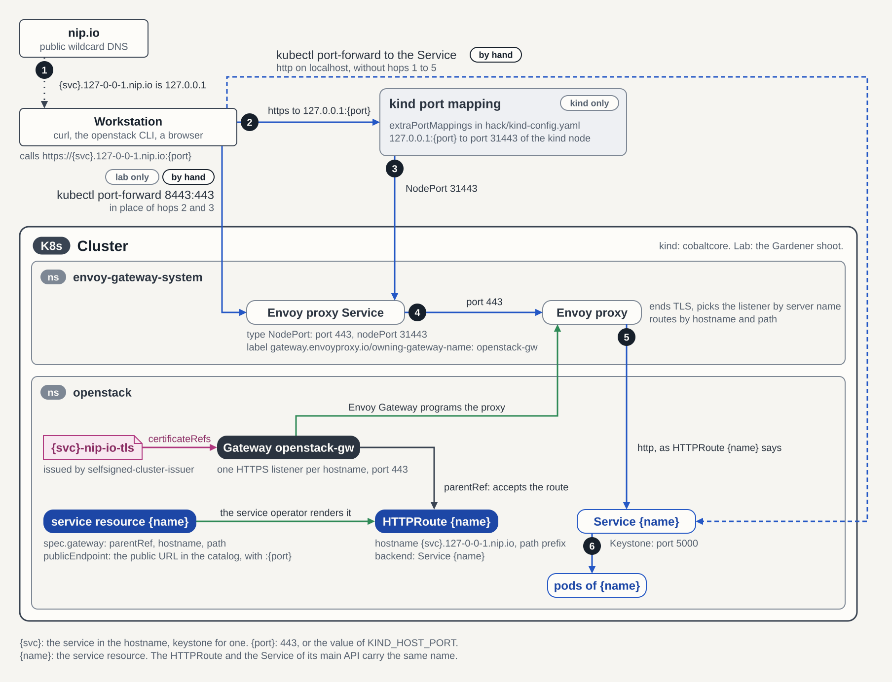

<!--
SPDX-FileCopyrightText: Copyright 2026 SAP SE or an SAP affiliate company
SPDX-License-Identifier: Apache-2.0
-->

# Deploy Keystone Locally

Deploy a standalone OpenStack identity service to explore Keystone or test
its operator. CobaltCore supplies its database, cache, secrets, and HTTPS
endpoint on a local kind cluster.

For a first CobaltCore deployment with a ControlPlane and dashboard, use the
[Quick Start](./quick-start.md). This standalone guide uses a separate
cluster; do not apply it over a ControlPlane deployment.

## Prerequisites

Allocate at least 2 CPU cores, 8 GB RAM, and 10 GB free disk to a running
Docker runtime. Use Docker Desktop on macOS. Install `git`, `make`, `jq`,
Mike Farah's `yq` v4.40.1 or newer, and `python-openstackclient` for the
final authentication check.

The [local Kubernetes guide](./deployment/local-kubernetes.md) covers
Podman requirements, port choices, and capacity. Helm is needed only for a
local chart build; the default path installs a published chart through Flux.

## Step 1 — Clone the repository

```bash
git clone https://github.com/c5c3/cobaltcore.git
cd cobaltcore
make install-test-deps
export PATH="${HOME}/.local/bin:${PATH}"
```

The installer supplies pinned kind, kubectl, and Chainsaw binaries. It does
not install Docker, Helm, jq, or yq. The Flux CLI is optional.

## Step 2 — Prepare a fresh cluster {#step-2-—-create-the-kind-cluster}

This guide creates the cluster named `cobaltcore`. If that name already
belongs to a ControlPlane deployment, follow the
[local cleanup instructions](./deployment/local-kubernetes.md#keep-deployment-modes-separate)
before continuing. The two deployment modes manage the backing services
differently.

Set the host port before cluster creation:

```bash
export KIND_HOST_PORT=8443
if kind get clusters | grep -qx cobaltcore; then
  kind export kubeconfig --name cobaltcore
  kubectl config use-context kind-cobaltcore
fi
```

Ports `8443` and `8428` must be free. The next step creates the cluster and
maps port `8443` to the Envoy proxy's NodePort `31443`. An existing cluster
keeps its original port mapping.

## Step 3 — Deploy the infrastructure stack {#step-3-deploy-the-infrastructure-stack}

The `deploy-infra` target runs an 8-step deployment sequence to prepare
Keystone's database, cache, and credentials:

```bash
EXTERNAL_CLUSTER=false WITH_CONTROLPLANE=false WITH_CONTROLPLANE_CR=false make deploy-infra
kubectl config use-context kind-cobaltcore
kubectl cluster-info --context kind-cobaltcore
```


| Step | What happens |
|------|-------------|
| 1 | Create the kind cluster, or reuse one that already exists. |
| 2 | Install flux-operator and wait for `FluxInstance/flux` to become ready. |
| 2a | Install the Gateway API CRDs. |
| 2b | Install the Envoy Gateway CRDs; the release and `Gateway/openstack-gw` follow in Step 3. |
| 3 | Apply `deploy/kind/base`, including namespaces, sources, and releases. |
| 4 | Wait for infrastructure releases and the RabbitMQ operator Kustomizations. |
| 5 | Apply `deploy/kind/infrastructure` and wait for the Gateway to become `Programmed`. |
| 6 | Wait for OpenBao to run. |
| 7 | Initialize and unseal OpenBao, then create bootstrap credentials. |
| 8 | Wait for the `keystone-admin`, `keystone-db`, and `mariadb-root-password` ExternalSecrets to sync. |

The script also waits for MariaDB to become ready. The standalone overlay
supplies those ExternalSecrets; a ControlPlane deployment creates its own
credentials and backing services.

Allow several minutes for initial image downloads. For a slower machine,
rerun with longer waits and the same deployment settings:

```bash
EXTERNAL_CLUSTER=false WITH_CONTROLPLANE=false WITH_CONTROLPLANE_CR=false \
HELMRELEASE_TIMEOUT=900 POD_TIMEOUT=600 make deploy-infra
```

The [deployment reference](./reference/infrastructure/e2e-deployment.md#deployment-sequence)
explains each wait and failure diagnostic.

::: details What gets deployed
The main workloads include:

```text
flux-system           flux-operator-*                Ready
flux-system           source-controller-*            Ready
flux-system           kustomize-controller-*         Ready
flux-system           helm-controller-*              Ready
flux-system           notification-controller-*      Ready
flux-system           flux-web-*                     Ready (kind-only; see Step 4a)
envoy-gateway-system  envoy-gateway-*                Ready
cert-manager          cert-manager-*                 Ready
mariadb-system        mariadb-operator-*             Ready
memcached-system      memcached-operator-*           Ready
external-secrets      external-secrets-*             Ready
shared-services       openbao-0                      Ready
openstack             openstack-db-*                 Ready
openstack             openstack-memcached-*          Ready
headlamp-system       headlamp-*                     Starting
```

Headlamp installs asynchronously. Step 4 waits for its UI when you use it.
:::

### Add observability or autoscaling

Optional components are described in the
[local deployment guide](./deployment/local-kubernetes.md#add-capacity-or-optional-services).
For example, `WITH_PROMETHEUS=true make deploy-infra` adds Prometheus and
Grafana; [Step 4c](#step-4c-grafana-ui) opens the dashboard.

Reruns should preserve your original settings. Removing an optional flag
does not uninstall its components. Switching to a ControlPlane requires a
fresh cluster.

::: tip Enabling Chaos Mesh
Failure-injection tests require `WITH_CHAOS_MESH=true make deploy-infra`.
Chaos Mesh is absent from the default installation. Review the
[chaos test prerequisites](./reference/testing/chaos-e2e-tests.md) before
running those tests.
:::

## Step 4 — Open the Headlamp UI

The UI sections are optional. Run each `kubectl port-forward` in a separate
terminal and keep it running while using that UI. Continue deployment commands
in your original repository shell, starting at Step 5.

The kind overlay ships [Headlamp](https://headlamp.dev/) with the Flux plugin preloaded, so
you can watch Steps 5 to 9 reconcile live (and, if you enabled `WITH_PROMETHEUS=true`, jump to
[Step 4c](#step-4c-grafana-ui) for the Grafana UI). Wait for the HelmRelease to become Ready, then
get a token, port-forward, and open the UI:

```bash
kubectl wait helmrelease/headlamp \
  -n headlamp-system \
  --for=condition=Ready \
  --timeout=300s

kubectl create token headlamp -n headlamp-system --duration=8h
kubectl port-forward svc/headlamp -n headlamp-system 8080:80
```

Open `http://localhost:8080`, paste the token. The sidebar shows **Flux → Helm Releases /
Kustomizations / Sources** alongside the standard resources. The `headlamp` ServiceAccount is
bound to a read-only ClusterRole covering Flux toolkit API groups and the CobaltCore CRDs.

### Accessing the Flux UI

The Headlamp Flux plugin is the primary Flux UI used by this project. The `flux-operator`
also ships an embedded Flux Web UI ([fluxoperator.dev/web-ui](https://fluxoperator.dev/web-ui/))
that the kind overlay turns on as a demo addon;
[Step 4a — Open the Flux Web UI](#step-4a-flux-web-ui) covers how to reach it.
Once Headlamp is open and you are authenticated, click **Flux** in the left sidebar
to switch into the Flux views:

| Pane | Shows |
|------|-------|
| **Helm Releases** | Every `HelmRelease` with reconciliation status, last applied revision, and the values that were rendered |
| **Kustomizations** | Flux-managed resources, including the RabbitMQ operators |
| **Sources** | `HelmRepository` objects (and `GitRepository`/`OCIRepository` if present) with the last successful fetch and artifact revision |
| **Flux Runtime** | The flux-operator's `FluxInstance/flux` and `FluxReport/flux` — controller versions, reconciliation state, entitlement status |

Use the resource views to inspect reconciliation status, controller logs,
and Kubernetes events.

---

## Step 4a — Open the Flux Web UI {#step-4a-flux-web-ui}

The kind overlay also ships the flux-operator's own
[Flux Web UI](https://fluxoperator.dev/web-ui/) as a demo surface (and, alongside it,
the optional Grafana UI from [Step 4c](#step-4c-grafana-ui) when `WITH_PROMETHEUS=true`).
The local overlay enables this demo UI without login. The base
`deploy/flux-system/` overlay keeps it disabled. Forward the service port:

```bash
kubectl port-forward svc/flux-web -n flux-system 9080:9080
```

Then open <http://localhost:9080>. No login is required.

The Web UI complements Headlamp (Step 4) by rendering the three flux-operator-specific
Custom Resources that the generic Headlamp Flux plugin does not know about: `ResourceSet`
and `ResourceSetInputProvider` (the operator's templating primitives) and `FluxReport`
(the rolled-up installation status of every Flux controller). Standard `HelmRelease`,
`Kustomization`, and `Source` views are still easier to read in Headlamp.

---

## Step 4b — Open the OpenBao UI {#step-4b-openbao-ui}

The kind overlay enables the OpenBao web UI as a demo surface (the optional
Grafana UI is covered separately in [Step 4c](#step-4c-grafana-ui)). This is a
kind-only convenience. The production flux-system overlay keeps `ui = false` in the HA
Raft config. Forward the client port and log in with the root token that
`make deploy-infra` already seeded into the cluster:

```bash
kubectl port-forward svc/openbao -n shared-services 8200:8200
```

> **Service selection:** `kubectl get svc -n shared-services` lists both OpenBao
> services (alongside the Garage ones sharing that namespace).
> Forward `svc/openbao` (the client `ClusterIP` service that also fronts the UI),
> **not** `svc/openbao-internal` (the headless Service used for Raft peer
> discovery between OpenBao pods).

In a second terminal, extract the root token from the `openbao-init-keys` Secret:

```bash
export BAO_TOKEN=$(kubectl get secret openbao-init-keys -n shared-services \
  -o jsonpath='{.data.init-output}' | base64 -d | jq -r '.root_token')
echo "$BAO_TOKEN"
```

### Present a client certificate (mutual TLS)

The listener enforces **mutual TLS**: every connection must present a client certificate that
chains to the in-cluster CA *before* the application-layer token login runs. A browser without
one never reaches the login screen: the TLS handshake is reset, which the tooling surfaces as
`connection reset by peer` / `lost connection to pod`. The kind overlay matches the production
mTLS posture here.

Build a PKCS#12 bundle from the `openbao-client-tls` Secret. Its keypair is signed by the same
CA as the server cert, `openbao-ca` (ClusterIssuer `openbao-ca-issuer`), and the listener
verifies only chain-to-CA (not SANs) on client auth, so this certificate is accepted:

```bash
kubectl get secret openbao-client-tls -n shared-services \
  -o jsonpath='{.data.tls\.crt}' | base64 -d > openbao-client.crt
kubectl get secret openbao-client-tls -n shared-services \
  -o jsonpath='{.data.tls\.key}' | base64 -d > openbao-client.key
kubectl get secret openbao-client-tls -n shared-services \
  -o jsonpath='{.data.ca\.crt}'  | base64 -d > openbao-ca.crt
# The passphrase only protects this throwaway local .p12 during the browser
# import — it is not an OpenBao credential, so pick any value you like.
openssl pkcs12 -export -inkey openbao-client.key -in openbao-client.crt \
  -certfile openbao-ca.crt -name "OpenBao Client (kind)" \
  -out openbao-client.p12 -passout pass:changeit
```

Import the bundle into Firefox once. This walkthrough is verified with Firefox;
Chrome, Edge, and Safari also accept client certificates but import them through
the OS keychain / system certificate store, so the menu path differs:

1. *Settings → Privacy & Security → Certificates → View Certificates…*
2. Tab **Your Certificates → Import…** → select `openbao-client.p12` and enter the
   passphrase you chose above.
3. *(Optional: removes the trust warning.)* Tab **Authorities → Import…** → select
   `openbao-ca.crt` → tick "Trust this CA to identify websites". The server cert carries
   `IP:127.0.0.1` as a SAN, so use `https://127.0.0.1:8200`; it has no
   `localhost` DNS SAN.

Open `https://127.0.0.1:8200/ui/`. Firefox asks which client certificate to send: pick
**"OpenBao Client (kind)"**, then paste the root token to sign in.

For the full token lifecycle, secret engines, auth methods, and the bootstrap sequence that
produced this token, see
[OpenBao Bootstrap Procedure — Running the Full Bootstrap](./reference/infrastructure/openbao-bootstrap.md#running-the-full-bootstrap).

---

## Step 4c — Open the Grafana UI {#step-4c-grafana-ui}

Enable the local Prometheus and Grafana stack with
`WITH_PROMETHEUS=true make deploy-infra`, preserving the standalone settings
from Step 3. It installs into the `monitoring` namespace.

Forward the Grafana service port:

```bash
kubectl port-forward svc/kube-prometheus-stack-grafana -n monitoring 3000:80
```

Open `http://localhost:3000` and sign in with the chart's default credentials:

```
username: admin
password: prom-operator
```

> **Default credentials only:** these are the upstream `kube-prometheus-stack`
> defaults baked into the kind overlay for convenience. Do not reuse them in
> any cluster reachable beyond your laptop.

Once signed in, navigate to **Dashboards → Keystone Operator** to see the
bundled dashboard sourced from `operators/keystone/dashboards/keystone-operator.json`
(reconcile p95, error rate, and the keystone-operator metrics).

### Sanity-check: Prometheus targets

In a second terminal, port-forward Prometheus and confirm the keystone-operator
ServiceMonitor scrape target is `up`. The query path
(`/api/v1/targets?state=active`) is the same one the chainsaw suite
issues against the in-cluster Service, so a green local check matches what
CI exercises:

```bash
kubectl port-forward svc/kube-prometheus-stack-prometheus -n monitoring 9090:9090
```

With that command running, query Prometheus from another terminal:

```bash
curl -fsS 'http://localhost:9090/api/v1/targets?state=active' \
  | jq '.data.activeTargets[] | select(.labels.job=="keystone-operator") | {health, lastScrape: .lastScrape}'
```

A healthy target reports `"health": "up"`; an empty result means the
keystone-operator HelmRelease has not been patched yet. Re-run
`WITH_PROMETHEUS=true make deploy-infra` so the deploy script can flip
`monitoring.serviceMonitor.enabled=true`.

For non-kind clusters (production overlays, shared dev clusters, anything that
already runs Prometheus), follow
[Enable Keystone Operator Metrics](./guides/keystone/enable-keystone-operator-metrics.md)
instead. That guide covers wiring an externally-managed Prometheus to the
operator's ServiceMonitor and is the canonical non-kind path.

---

## Step 5 — Deploy the Keystone operator

Install the published Keystone operator chart and wait for it to become ready.

### Install the published chart {#option-a-—-from-ghcr-recommended-for-users}

Install the published chart directly from the GHCR OCI registry. Flux reconciles updates
automatically:

```bash
# Add the HelmRepository source (already present if you ran make deploy-infra)
kubectl apply -f deploy/flux-system/sources/c5c3-charts.yaml

# Apply the HelmRelease — Flux installs the chart and keeps it reconciled
kubectl apply -f deploy/flux-system/releases/keystone-operator.yaml

# Wait until the operator is Ready
kubectl wait helmrelease/keystone-operator \
  -n keystone-system \
  --for=condition=Ready \
  --timeout=120s
```

The `HelmRelease` selects the chart version range declared in
`deploy/flux-system/releases/keystone-operator.yaml` and deploys two replicas
with leader election.

### Build a local operator {#option-b-—-from-the-local-helm-chart-recommended-for-development}

For operator development, follow
[Build and Test Locally](./contributing/build-and-test-locally.md#build-operator)
in place of the published-chart installation above. It requires a Linux
Nix build environment.

### Verify the operator is running

```bash
kubectl get pods -n keystone-system -l app.kubernetes.io/name=keystone-operator
```

Expected output:

```
NAME                                  READY   STATUS    RESTARTS   AGE
keystone-operator-6d7f9f4d5b-abc12   1/1     Running   0          30s
keystone-operator-6d7f9f4d5b-xyz99   1/1     Running   0          30s
```

---

## Step 6 — Choose the Keystone service image {#step-6-—-prepare-and-load-the-keystone-service-image}

Choose the release for the resource manifest in Step 7:

```bash
RELEASE=2026.1
```

### Use the published image {#option-a-—-pull-from-ghcr-recommended}

The kind node pulls `ghcr.io/c5c3/keystone:2026.1` directly when you create
the Keystone resource. No host-side image load is needed. This also avoids
multi-platform image import failures with Docker's containerd image store.

### Build locally {#option-b-—-build-locally}

To test changes to Keystone itself, use the
[service image build instructions](./contributing/build-and-test-locally.md#build-service-image).

## Step 7 — Create a Keystone CR

Save the following as `keystone.yaml`. Replace `<RELEASE>` with `2026.1`,
the release selected in Step 6. The operator creates Keystone's database in
`openstack-db` and uses `openstack-memcached` for caching. The namespaced
`openbao-tenant-store` supplies its tenant credentials.

The Gateway exposes the API on port `8443`. `publicEndpoint` makes Keystone
advertise that same reachable URL in its service catalog.

```yaml
# keystone.yaml
apiVersion: keystone.openstack.c5c3.io/v1alpha1
kind: Keystone
metadata:
  name: keystone
  namespace: openstack
spec:
  secretStoreRef:
    kind: SecretStore
    name: openbao-tenant-store
  deployment:
    replicas: 3
  image:
    repository: ghcr.io/c5c3/keystone
    tag: "<RELEASE>"   # e.g. 2026.1, selected in Step 6
  database:
    clusterRef:
      name: openstack-db
    database: keystone
    secretRef:
      name: keystone-db
  cache:
    clusterRef:
      name: openstack-memcached
    backend: dogpile.cache.pymemcache
  fernet:
    rotationSchedule: "0 0 * * 0"   # weekly rotation, every Sunday at midnight
    maxActiveKeys: 3
  bootstrap:
    adminUser: admin
    adminPasswordSecretRef:
      name: keystone-admin
    region: RegionOne
    publicEndpoint: https://keystone.127-0-0-1.nip.io:8443/v3
  # Routes the public endpoint to
  # the keystone Service via the shared openstack-gw Gateway.
  gateway:
    parentRef:
      name: openstack-gw
    hostname: keystone.127-0-0-1.nip.io
    path: /
```

```bash
kubectl apply -f keystone.yaml
```

## Step 8 — Wait for Keystone to become Ready

The operator reconciles the CR through sixteen sub-conditions before the
aggregate `Ready` condition is set. The table also includes
`ExtraConfigHealthy`, which is advisory and does not gate readiness. Conditions
tied to an optional spec field carry a "not required" / "disabled" reason when that
field is unset:

| Condition | What it waits for |
|-----------|-------------------|
| `SecretsReady` | `keystone-db` and `keystone-admin` Secrets are available |
| `FernetKeysReady` | Fernet key Secret and CronJob created |
| `CredentialKeysReady` | Credential key Secret and rotation CronJob exist (`spec.credentialKeys` tunes schedule and max active keys) |
| `DatabaseReady` | `db_sync` Job completed successfully |
| `DatabaseTLSReady` | Database TLS client certificate issued, or `NotRequired` when `spec.database.tls` is unset |
| `PolicyValidReady` | `spec.policyOverrides` validated against `oslo.policy` |
| `ExtraConfigHealthy` | Reports whether `spec.extraConfig` overrides operator-owned keys; overrides emit a warning but are still applied |
| `DeploymentReady` | Keystone API Deployment has available replicas |
| `KeystoneAPIReady` | Keystone API is responding to `/v3` health probes |
| `HPAReady` | HorizontalPodAutoscaler created (if `spec.autoscaling` is set) |
| `VPAReady` | VerticalPodAutoscaler applied, or `VPANotRequired` when `spec.deployment.verticalAutoscaling` is unset |
| `NetworkPolicyReady` | NetworkPolicy created (if `spec.networkPolicy` is set) |
| `HTTPRouteReady` | Gateway API HTTPRoute reconciled, or not required when `spec.gateway` is unset |
| `BootstrapReady` | Bootstrap Job completed (admin user, region, endpoints) |
| `TrustFlushReady` | Trust-flush CronJob created (defaults to hourly) |
| `PasswordRotationReady` | Scheduled admin-password rotation reconciled, or `RotationDisabled` when `spec.passwordRotation` is unset |
| `IdentityBackendsReady` | Attached identity backends projected, or `IdentityBackendsNotRequired` when none is attached |

Watch the conditions with:

```bash
kubectl get keystone keystone -n openstack -w
```

Or wait for `Ready=True`:

```bash
kubectl wait keystone/keystone \
  -n openstack \
  --for=condition=Ready \
  --timeout=5m
```

Expected output (once reconciled):

```
keystone.keystone.openstack.c5c3.io/keystone condition met
```

---

## Step 9 — Verify the deployment

### Check all owned resources

```bash
# Deployment and Service
kubectl get deployment,service -n openstack -l app.kubernetes.io/instance=keystone

# Fernet rotation CronJob and Secret
kubectl get cronjob,secret -n openstack -l app.kubernetes.io/instance=keystone

# ConfigMap (name includes a content-hash suffix)
kubectl get cm -n openstack | grep keystone-config-
```

### Query the Keystone API

Run a request from a ready Keystone pod to reach the API service:

```bash
kubectl exec -n openstack deployment/keystone -- python3 -c \
  "import urllib.request; print(urllib.request.urlopen('http://keystone.openstack.svc:5000/v3').read().decode())"
```

A successful response is a JSON document with a `version` object and an API
version such as `v3.14`.

### Inspect conditions in detail

```bash
kubectl get keystone keystone -n openstack -o jsonpath='{.status.conditions}' | jq .
```

---

## Access Keystone from your local machine

The Keystone API is available at
`https://keystone.127-0-0-1.nip.io:8443/v3`. The nip.io hostname resolves to
`127.0.0.1`, and kind maps the host port to the shared Envoy Gateway.



### Step 1 — Export OpenStack credentials

Read the admin password directly from the cluster and set the standard OpenStack
environment variables against the nip.io endpoint:

```bash
export OS_AUTH_URL=https://keystone.127-0-0-1.nip.io:8443/v3
export OS_USERNAME=admin
export OS_PASSWORD=$(kubectl get secret keystone-admin -n openstack -o jsonpath='{.data.password}' | base64 -d)
export OS_PROJECT_NAME=admin
export OS_USER_DOMAIN_NAME=Default
export OS_PROJECT_DOMAIN_NAME=Default
```

### Step 2 — Verify access

Check that the API responds and that authentication works:

```bash
# Unauthenticated version endpoint (-k skips verification; see below)
curl -k https://keystone.127-0-0-1.nip.io:8443/v3

# Authenticated token request (requires python-openstackclient)
openstack --insecure token issue
```

A successful `curl` response contains a `version` object with an API version
such as `v3.14`. A successful
`openstack token issue` prints a table with the issued token and its expiry.

This deployment exposes only Keystone. Deploy a
[ControlPlane](./quick-start-controlplane.md) to add other OpenStack services.

### Accept the self-signed certificate

The Gateway terminates TLS with a certificate issued by the in-cluster
`selfsigned-cluster-issuer`, which is not in any OS trust store. Pick one of:

**Option A — quick, one-off runs:** pass `-k` / `--insecure` on the CLI.

```bash
curl -k https://keystone.127-0-0-1.nip.io:8443/v3
openstack --insecure token issue
# Or set the environment variable once per shell:
export OS_INSECURE=true
```

**Option B — trust the issuer (recommended for repeated use):** extract the
self-signed CA from the cluster and point OpenStack tooling at it.

```bash
# Extract the issuer's CA bundle to a local file
kubectl get secret keystone-nip-io-tls -n openstack \
  -o jsonpath='{.data.ca\.crt}' | base64 -d > keystone-ca.crt
export OS_CACERT="$(pwd)/keystone-ca.crt"

# Now curl and the OpenStack CLI accept the cert
curl --cacert "$OS_CACERT" https://keystone.127-0-0-1.nip.io:8443/v3
openstack token issue
```

### Fallback — `kubectl port-forward` {#fallback-kubectl-port-forward}

If the Gateway is unavailable (Envoy still reconciling, nip.io blocked by a corporate
resolver, or you are debugging the in-cluster Service directly), fall back to
port-forwarding the `keystone` Service and pointing `OS_AUTH_URL` at `localhost`:

```bash
# In a separate terminal:
kubectl port-forward svc/keystone -n openstack 5000:5000

# Then, in your shell:
export OS_AUTH_URL=http://localhost:5000/v3
curl http://localhost:5000/v3
openstack token issue
```

This reaches the ClusterIP Service directly and bypasses the Gateway data plane entirely.

### The request path, hop by hop {#request-path}

Use the failing hop to narrow a connection problem:

| Hop | Check |
| --- | --- |
| DNS | `keystone.127-0-0-1.nip.io` must resolve to `127.0.0.1`; DNS rebind protection can block it. |
| Host port | The cluster must have been created with `KIND_HOST_PORT=8443`. |
| NodePort | The kind mapping forwards to port `31443` on the Envoy proxy Service. |
| Gateway | `Gateway/openstack-gw` must be `Programmed`; the client must accept its lab certificate. |
| HTTPRoute | The Keystone operator attaches the hostname and `/` path to the Gateway. Check `HTTPRouteReady` if it returns `404`. |
| Service and pods | Envoy forwards HTTP to the `keystone` Service on port `5000`. |

`spec.bootstrap.publicEndpoint` controls the catalog URL. Keep it aligned
with the externally reachable endpoint, including its port. The
[port-forward fallback](#fallback-kubectl-port-forward) checks the Service
directly and bypasses the Gateway.

## Next steps

Use these guides to operate and configure the running service:

| Guide | When to read it |
|-------|-----------------|
| [Observability & Diagnostics](./guides/observability.md) | First stop when something is not `Ready` — how to read conditions, events, and status fields |
| [Day 2 Operations](./guides/day-2-operations.md) | Scale, upgrade the OpenStack release, rotate Fernet keys manually |
| [Advanced Configuration](./guides/advanced-configuration.md) | Brownfield database, autoscaling, network policy, free-form INI, and pointers to every other `spec.*` option |
| [Attach an OIDC Federation Backend](./guides/keystone/oidc-federation.md) | Federate Keystone with an OpenID Connect identity provider (Keycloak walkthrough) |

For the full field reference of the Keystone CR, see
[Keystone CRD API Reference](./reference/keystone/keystone-crd.md).

---

## Run E2E tests {#running-the-e2e-test-suite}

Follow [Run E2E Tests](./tutorials/run-e2e-tests.md) to check reconciliation,
resource cleanup, and API access on a disposable cluster.

## Run Tempest API tests {#running-tempest-api-tests}

The [Tempest walkthrough](./tutorials/run-e2e-tests.md#run-tempest) uses a
published test image to verify Keystone's identity API. Local image builds
are covered in [Build and Test Locally](./contributing/build-and-test-locally.md).

## Teardown

Delete the kind cluster and all its resources:

```bash
EXTERNAL_CLUSTER=false make teardown-infra
```

This deletes the `cobaltcore` cluster and its data. Registry caches, if
enabled, remain until removed with
`EXTERNAL_CLUSTER=false PURGE_REGISTRY_CACHE=true make teardown-infra`.
